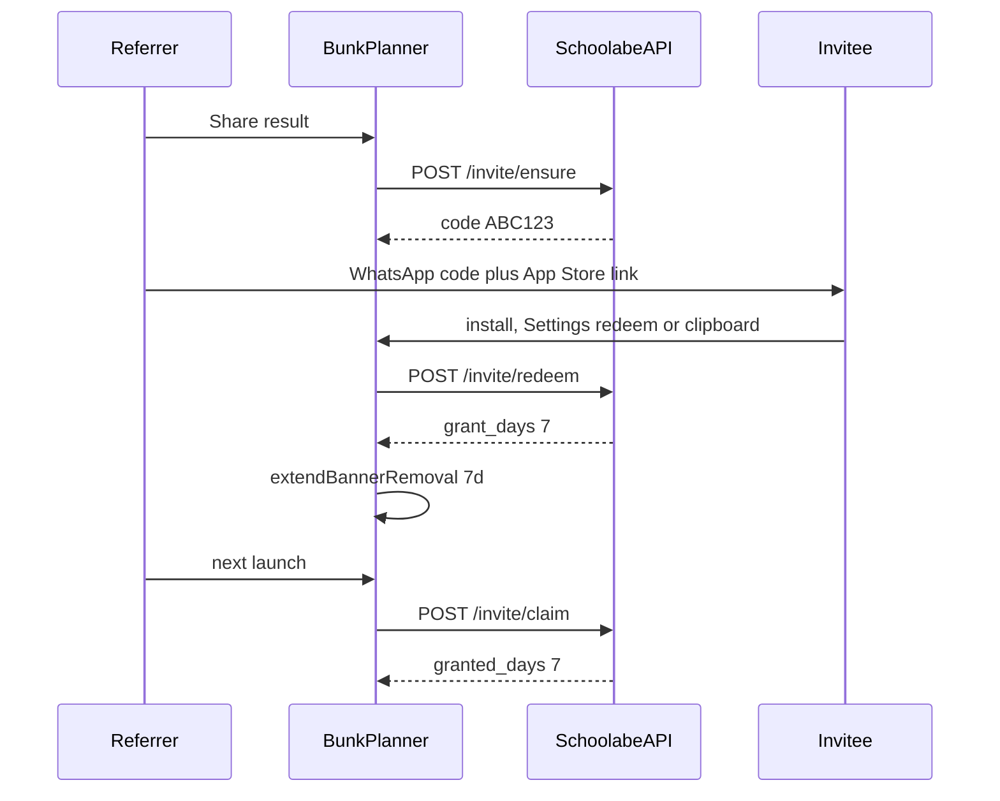

# Bunk Planner invite / referral loop

**Status:** Schoolabe FastAPI + iOS client. Deploy `alembic upgrade r0s1t2u3v4w5` on api.schoolabe.com to go live.  
**Choice locked:** Schoolabe backend (same `client_user_id` as `/sync`). Not Firebase Auth, not Branch.

**Overview:** Shareable 6-character invite codes credit both users with 7 days ad-free when a friend installs and redeems.

**Reward:** Both referrer and invitee get **7 days ad-free** via `AdEntitlementsStore.extendBannerRemoval`. No Pro IAP giveaway.

Friends typically paste the code in WhatsApp. Already-installed users can also open `bunkplanner://invite/CODE`.



---

## Architecture

| Piece | Role |
|-------|------|
| **Anonymous `client_user_id`** | Same UUID already used for `/sync` and `/events` |
| **Postgres** | `bunk_planner_invites`, `bunk_planner_redemptions`, pending days on `bunk_planner_users` |
| **Schoolabe API** | `POST /api/v1/bunk-planner/invite/ensure\|redeem\|claim` |
| **iOS app** | Share code, redeem UI, `onOpenURL`, clipboard scan, grant ads |

**Anti-fraud:**

- Cannot redeem own code
- One redemption per `client_user_id` ever
- Cap successful referrals per referrer (**10 / 30 days**)
- Code = 6-char Crockford base32 from uid hash

---

## Schoolabe API

- `POST /invite/ensure` `{ client_user_id }` → `{ code, url, redeem_count }`
- `POST /invite/redeem` `{ client_user_id, code }` → `{ grant_days: 7 }` or `detail`: `already_redeemed`, `not-found`, `self_redeem`, `cap_reached`
- `POST /invite/claim` `{ client_user_id }` → `{ granted_days, redeem_count, code }`

Deploy: `alembic upgrade r0s1t2u3v4w5` in `schoolabe-be-fastapi`.

---

## iOS app

**Identity:** `AnalyticsService.shared.userId` (no Firebase Auth).

**Share copy:**

```text
Try Bunk Planner with my invite code ABC123 — 7 days ad-free.
https://apps.apple.com/app/id6761951427
```

**Settings:** “Invite friends” — code, copy code, redeem, “X friends joined · Y days ad-free earned”.

**App entry:** `.onOpenURL` for `https://schoolabe.com/i/...` and `bunkplanner://invite/CODE`.

**Analytics:** `invite_link_shared`, `invite_redeem_started`, `invite_redeem_succeeded`, `invite_redeem_failed(reason)`, `referral_reward_claimed(days)`.

---

## Verification

1. Deploy Schoolabe migration + API.
2. Device A: share → 6-character code appears.
3. Device B: redeem → 7d ads off; Device A claim → 7d ads off.
4. Reject self-redeem, second redeem, over cap.
5. Analytics `invite_*` funnel visible.
